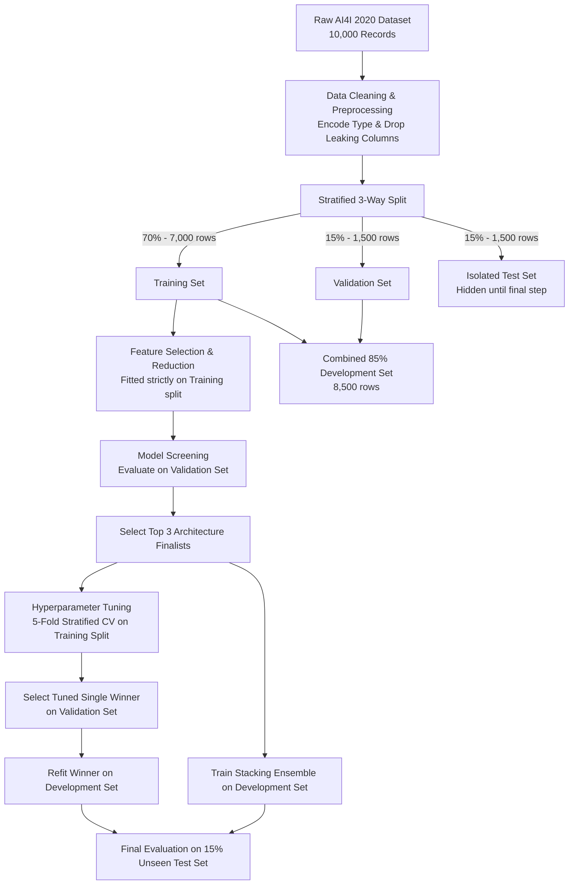

# 🛠️ Predictive Maintenance: Machine Failure Classification
> **Machine Learning Term Project**  
> *A Comparative Study of Feature Reduction Strategies and Machine Learning Classifiers for Industrial Fault Detection*

[](https://www.python.org/)
[](https://scikit-learn.org/)
[]()

---

## 📌 Executive Summary

Unexpected industrial equipment downtime costs factories billions of dollars annually. While early warning systems are crucial, **machine failures in real-world operations are rare events**, making standard classification metrics like accuracy deceptive.

This project delivers a **leak-free, reproducible machine learning pipeline** that:
1. Evaluates whether reduced sensor subsets can effectively detect industrial machine failures.
2. Compares **8 feature reduction strategies** (Filter, Embedded, Wrapper, and Dimensionality Reduction methods).
3. Benchmarks **6 core classifier families** plus a multi-model **Stacking Ensemble**.
4. Solves severe class imbalance (~3.39% failure rate) by prioritizing **Failure F1-Score**, **Recall** (minimizing costly missed failures), and **Precision** (avoiding false alarms).

The final champion model—a **fine-tuned Gradient Boosting Classifier** using all 6 physical sensor features—achieved an **F1-Score of 81.32%**, **72.55% Recall**, and **92.50% Precision** on an isolated, untouched test set, producing only **3 false alarms** across 1,500 unseen production instances.

---

## 📊 Dataset & Sensor Features

The study utilizes the **AI4I 2020 Predictive Maintenance Dataset** (UCI Machine Learning Repository / Kaggle), consisting of 10,000 synthetic instances reflecting real milling machine operations.

### Target Variable
- **`Machine failure`** (Binary):
  - `0`: Normal operation (~96.61% — 9,661 samples)
  - `1`: Machine failure (~3.39% — 339 samples)

### Usable Sensor Predictors (6 Features)
| Sensor Feature | Type | Units | Industrial Meaning |
| :--- | :---: | :---: | :--- |
| **`Type`** | Categorical | Encoded (0: L, 1: M, 2: H) | Product quality variant (Low 50%, Medium 30%, High 20%) |
| **`Air temperature [K]`** | Continuous | Kelvin | Ambient factory temperature |
| **`Process temperature [K]`** | Continuous | Kelvin | Internal machine operating temperature |
| **`Rotational speed [rpm]`** | Continuous | RPM | Spindle rotational speed |
| **`Torque [Nm]`** | Continuous | Newton-meters | Torque resistance during operation |
| **`Tool wear [min]`** | Continuous | Minutes | Cumulative tool cutting time in contact with workpieces |

> [!NOTE]  
> **Target Leakage Prevention**: Identifiers (`UDI`, `Product ID`) and specific root-cause failure indicators (`TWF`, `HDF`, `PWF`, `OSF`, `RNF`) were strictly excluded from model inputs. In real-time monitoring, specific failure types are unknown prior to diagnosis; including them would leak the target label.

---

## 🔬 Experimental Methodology

A rigorous, leak-free experimental design guarantees that evaluation metrics reflect true generalization performance.



### 1. Stratified Partitioning
- **Training Set (70% — 7,000 samples)**: Used exclusively for fitting feature selectors, training initial models, and 5-fold cross-validation.
- **Validation Set (15% — 1,500 samples)**: The "practice exam"—used to compare feature sets, screen model families, and select the winning hyperparameter configuration.
- **Test Set (15% — 1,500 samples)**: The "final exam"—completely untouched until after all selection and tuning decisions are frozen.
- **Development Set (85% — 8,500 samples)**: Once the optimal configuration is locked, Training and Validation data are merged to refit the final model before testing.

### 2. Feature Selection Strategies Compared
All selectors were constrained to select **4 features** (or 95% variance) for a fair head-to-head comparison:
- **Baseline**: All 6 raw features (benchmark).
- **Filter Methods**:
  - **ANOVA F-Test** (`SelectKBest(f_classif)`): Statistical variance differences between normal and failure states.
  - **Pearson Correlation**: Absolute linear correlation with the failure label.
- **Embedded Methods**:
  - **Adapted Lasso ($L_1$)**: Feature pruning based on sparse $L_1$ logistic regression coefficients.
  - **Regularization Analysis**: Comparative study of Ridge ($L_2$), Lasso ($L_1$), and Elastic Net ($L_1 + L_2$).
- **Wrapper Methods**:
  - **Recursive Feature Elimination (RFE)**: Tested with Logistic Regression, Linear SVC, Decision Tree, and Random Forest.
  - **Sequential Feature Selector (SFS)**: Forward and Backward greedy selection driven by cross-validated F1 score.
- **Dimensionality Reduction**:
  - **PCA**: Retains 95% cumulative variance across 4 orthogonal components.

### 3. Machine Learning Classifiers
Six diverse algorithm families were benchmarked across each feature set:
1. **Support Vector Classifier (SVC)** (Linear, Polynomial, RBF kernels)
2. **Logistic Regression** (with balanced class weights)
3. **Decision Tree** (Gini impurity / Entropy)
4. **Random Forest** (Bagging ensemble)
5. **Gradient Boosting** (Sequential boosting ensemble)
6. **Multilayer Perceptron (MLP)** (Deep neural network with hidden layers `(64, 16)`)
7. **Stacking Ensemble** (Meta-classifier combining the top 3 tuned architectures)

---

## 🏆 Key Results & Performance

### 1. Validation Screening (Top Model per Feature Method)

| Feature Selection Method | Best Model | Validation F1 | Validation Recall | Validation Precision | Missed Failures (FN) | False Alarms (FP) |
| :--- | :---: | :---: | :---: | :---: | :---: | :---: |
| **No feature selection (All 6)** | **MLP** | **0.7692** | **0.6863** | **0.8750** | **16** | **5** |
| RFE (Logistic Regression) | MLP | 0.7021 | 0.6471 | 0.7674 | 18 | 10 |
| ANOVA Filter | MLP | 0.6742 | 0.5882 | 0.7895 | 21 | 8 |
| Pearson Correlation | MLP | 0.6742 | 0.5882 | 0.7895 | 21 | 8 |
| Adapted Lasso ($L_1$) | MLP | 0.6742 | 0.5882 | 0.7895 | 21 | 8 |
| Forward SFS (Decision Tree) | MLP | 0.6742 | 0.5882 | 0.7895 | 21 | 8 |
| Backward SFS (Decision Tree)| MLP | 0.6353 | 0.5294 | 0.7941 | 24 | 7 |
| PCA (95% Variance) | MLP | 0.5000 | 0.3529 | 0.8571 | 33 | 3 |

### 2. Hyperparameter Fine-Tuning (5-Fold Cross-Validation on Top 3 Finalists)

After screening, the top 3 distinct architectures were fine-tuned with 5-fold cross-validation on the training set:

| Architecture | Optimal Hyperparameters | Validation F1 | Validation Recall | Validation Precision |
| :--- | :--- | :---: | :---: | :---: |
| **Gradient Boosting** | `learning_rate=0.1`, `max_depth=5`, `n_estimators=200`, `subsample=1.0` | **0.7865** | **0.6863** | **0.9211** |
| **Random Forest** | `n_estimators=200`, `max_depth=None`, `min_samples_leaf=1`, `balanced` | 0.7778 | 0.6863 | 0.8974 |
| **MLP Neural Network** | `hidden_layer_sizes=(64, 16)`, `alpha=0.001`, `max_iter=1000` | 0.7579 | 0.7059 | 0.8182 |

### 3. Final Unseen Test Set Performance: Single Winner vs. Stacking Ensemble

The winning Gradient Boosting model and the Stacking Ensemble were refit on the combined 85% development set and evaluated **once** on the 1,500 unseen test samples:

| Model Strategy | Input Features | Test F1 | Test Recall | Test Precision | Balanced Acc. | Missed Failures | False Alarms |
| :--- | :--- | :---: | :---: | :---: | :---: | :---: | :---: |
| **Gradient Boosting (Winner)** | **All 6 Sensors** | **0.8132** | **72.55%** | **92.50%** | **86.17%** | **14 / 51** | **3 / 1,449** |
| Stacking Ensemble (Top 3) | All 6 Sensors | 0.7912 | 70.59% | 90.00% | 85.16% | 15 / 51 | 4 / 1,449 |

---

## 💡 Key Engineering Takeaways

1. **Why Full Features Outperformed Feature Reduction**:
   - Physical machine failures depend on non-linear thermodynamic and mechanical interactions:
     - **Power Failures (PWF)** depend on the product of `Rotational speed` and `Torque`.
     - **Heat Dissipation Failures (HDF)** depend on the difference between `Process temperature` and `Air temperature`.
     - **Overstrain Failures (OSF)** depend on the product of `Tool wear` and `Torque`.
   - Pruning any of these 6 sensors removes a critical variable required to detect at least one physical failure mode.
2. **Single Model vs. Stacking Ensemble**:
   - The tuned **Gradient Boosting Classifier** outperformed the multi-model Stacking Ensemble on unseen test data (F1: 81.32% vs. 79.12%).
   - In industrial production, a single tree-based model is faster to execute, lighter on inference latency, and simpler to maintain than a multi-architecture ensemble.
3. **Low False Alarms in Industrial Context**:
   - Achieving **92.50% Precision** with only **3 false alarms out of 1,449 normal runs** prevents costly unnecessary maintenance shutdowns while capturing over 72% of critical failures before catastrophic breakdowns.

---

## 📁 Repository Structure

```text
ML_Term_Project/
├── Predictive_Maintenance_Version 2_Res.ipynb  # Master Jupyter Notebook containing full pipeline
├── Report/
│   ├── latest_experiment_report.md             # Auto-generated summary of the latest experiment run
│   └── experiment_runs_log.txt                 # Cumulative run history log across different configs
└── README.md                                   # Comprehensive project documentation
```

---

## 🚀 Getting Started & Reproducibility

### Prerequisites
- Python 3.9+
- Standard data science libraries:

```bash
pip install numpy pandas matplotlib seaborn scikit-learn kagglehub
```

### Running the Notebook
1. Clone or open this repository in your local environment or VS Code.
2. Open [`Predictive_Maintenance_Version 2_Res.ipynb`](./Predictive_Maintenance_Version%202_Res.ipynb).
3. The dataset is automatically fetched via `kagglehub`.
4. Run all cells from top to bottom.

### Configuring New Experiments
In **Section 7 (Master Experiment Configuration)** of the notebook, you can customize:
```python
NUMBER_OF_FEATURES = 4            # Number of features to select (ANOVA, Correlation, Lasso, RFE, SFS)
RFE_SELECTOR_MODEL = "Logistic Regression"  # Base model for RFE
SFS_SELECTOR_MODEL = "Decision Tree"        # Base model for Forward/Backward SFS
PCA_VARIANCE       = 0.95         # Cumulative variance retained by PCA
CV_FOLDS           = 5            # Number of folds for cross-validation
UNIQUE_FINALIST_MODELS = False    # True = force 3 distinct architectures in finalists
```
Running **Section 19** will automatically log your experiment configuration and results to [`Report/latest_experiment_report.md`](./Report/latest_experiment_report.md) and [`Report/experiment_runs_log.txt`](./Report/experiment_runs_log.txt).

---

## 👥 Authors & Academic Context
- **Course**: Machine Learning (Lab & Term Project Assignment)
- **Year & Semester**: Year 3 (Junior), Semester 1
- **Institution**: Silpakorn University
